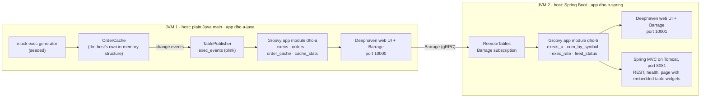

# 01. Design: Deephaven Community embedded in Java applications

**Goal.** A demo repository that shows Deephaven Community Core (DHC) running **inside** two
kinds of host application, a Spring Boot application and a plain Java application with its own
`main`, as an internal UI and query module over the host's own in-memory data. Two embedded
instances talk to each other: **DHC A** produces mock order-execution data, **DHC B** subscribes
to A's tables and derives its own.

**Fixed choices** (from the request): Deephaven 42.4, Gradle 9.2, Java 21, Groovy application-mode
modules, Gradle subprojects with shared Java code under `framework/` and one subproject per
embedded application under `apps/`, plus top-level `config`, `scripts`, `docs`, `build-logic` and
`docker`.

Every "F*n*" below refers to a finding in [00 Feasibility spike](00-feasibility-spike.md).

## 1. Shape of the solution



Two ideas keep it small:

1. **A role is a module, a host is a launcher.** What an instance *does* (role A: publish
   executions; role B: subscribe and derive) lives in a role module: a Groovy application-mode
   module plus the Java it calls. How the JVM is started (plain `main` or Spring Boot) lives in a
   host app of a few dozen lines. Any role runs in any host, so the demo can show all four
   combinations without duplicating logic.
2. **Groovy composes, Java implements.** The Groovy scripts are the readable list of tables an
   instance exposes. Anything with logic (the generator, the cache, publishing, subscribing) is
   Java in `framework/`, unit-tested without an engine where possible.

One Deephaven engine exists per JVM (F10), so A and B are always two processes.

## 2. Repository layout

```
deephaven-community-embedded/
├── settings.gradle.kts             # includes build-logic, lists subprojects
├── build.gradle.kts                # aggregate tasks only
├── gradle/
│   ├── libs.versions.toml          # every version in one place
│   ├── gradle-daemon-jvm.properties # the Gradle daemon runs on Java 21 too
│   └── wrapper/                    # Gradle 9.2.x
├── build-logic/                    # included build: convention plugins (section 3)
│   └── repositories-plugin/        # included build: the dhc.repositories settings plugin
├── framework/                      # shared Java code
│   ├── embed-core/                 # start/stop, component factory, settings, engine access
│   ├── embed-spring/               # Spring Boot auto-configuration around embed-core
│   ├── embed-testkit/              # JUnit support, table assertions, the probe client
│   └── orders-model/               # ExecEvent, OrderCache, mock generator, table definitions, oracle
├── apps/                           # embedded DHC applications
│   ├── dhc-a-module/               # role A: Groovy app module + the Java it calls
│   ├── dhc-b-module/               # role B
│   ├── dhc-a-java/                 # host: plain Java main running role A   (primary)
│   ├── dhc-b-spring/               # host: Spring Boot running role B       (primary)
│   ├── dhc-a-spring/               # host: Spring Boot running role A       (phase 6)
│   └── dhc-b-java/                 # host: plain Java main running role B   (phase 4)
├── config/                         # environment and application settings, artifact sources
├── scripts/                        # run, demo, smoke, checks (bash 3.2 compatible)
├── docker/                         # Dockerfiles, compose file, image build tasks
└── docs/
```

`config`, `scripts`, `docker` and `docs` are registered as Gradle subprojects with the `base`
plugin so each can own tasks (`validateConfig`, `checkScripts`, `buildImages`, `checkDocs`) and
take part in `./gradlew check`.

Gradle project paths: `:framework:embed-core`, `:apps:dhc-a-java`, and so on.

Java packages share the base `io.github.cmh.dhc` (decision D8), one sub-package per module.
`dhc` is Deephaven Community Core, here and in the plugin ids and `DHC_*` keys. The first plan
used `dhe`; it was renamed because DHE is the usual short name for Deephaven Enterprise, which
this project does not use:

| Module | Package |
|---|---|
| `framework/embed-core` | `io.github.cmh.dhc.embed` |
| `framework/embed-spring` | `io.github.cmh.dhc.embed.spring` |
| `framework/embed-testkit` | `io.github.cmh.dhc.testkit` |
| `framework/orders-model` | `io.github.cmh.dhc.orders` |
| `apps/dhc-a-module`, `apps/dhc-b-module` | `io.github.cmh.dhc.apps.dhca`, `io.github.cmh.dhc.apps.dhcb` |
| host apps | `io.github.cmh.dhc.apps.dhca.java`, `...dhca.spring`, `...dhcb.java`, `...dhcb.spring` |

The Gradle group is `io.github.cmh.dhc` as well.

## 3. Build logic

An included build, `build-logic/`, holds convention plugins written in the Kotlin DSL. Subproject
build files then contain only a plugin id and their dependencies.

`dhc.repositories` is the exception: it is plain Java in a second included build,
`build-logic/repositories-plugin/`, which has no dependencies and declares no repositories.
build-logic needs repositories itself (for the Kotlin DSL and Spring Boot plugins), so the plugin
that declares them cannot be built by build-logic. Kept apart, it is applied by the root build,
by build-logic and by the test fixture builds alike, and the rule "repositories come from
`repos.env` only" has no exception.

| Plugin id | Applied to | What it fixes in one place |
|---|---|---|
| `dhc.repositories` (settings plugin) | the whole build | every repository URL comes from `config/repos/repos.env`; modules may not declare repositories (`FAIL_ON_PROJECT_REPOS`) |
| `dhc.java-conventions` | every Java module | Java 21 toolchain, UTF-8, warnings as errors (`-Xlint:all` without `processing`, which Dagger's processor path would trip), JUnit 5, reproducible archives |
| `dhc.deephaven-library` | `framework/*`, role modules | Deephaven BOM as an enforced platform (F9), the Kafka extension excluded (F2), Dagger and its processor (F1), the mandatory JVM flags on tests (F3), a JVM of its own for every test class (F10), javac's `classfile` lint off (Deephaven's classes refer to annotations it does not publish) |
| `dhc.groovy-app-module` | `apps/*-module` | packages `src/main/appmode/` into the jar under `META-INF/dhc/app.d/` with an index of its files; `validateAppModule` checks the `.app` keys, that each `file_N` exists and that every script parses, and a module that fails it is not packaged. It runs on the module's own classpath, so scripts are parsed by Deephaven's Groovy 3 and not by Gradle's Groovy 4 |
| `dhc.embedded-java-app` | plain Java hosts | `application` plugin; the mandatory JVM flags (F3) on `run`, tests and the start script; Logback as the SLF4J backend; `run` takes its settings from the repository's `config/` with the environment `dev` and a work directory under `build/`, the installed distribution gets none of them |
| `dhc.embedded-spring-app` | Spring hosts | Spring Boot plugin **without** `io.spring.dependency-management` (applying it fails the build), Spring's BOM as a plain platform and every library Deephaven brings pinned to Deephaven's version (F9), Tomcat WebSocket excluded (F8), JVM flags on `bootRun` and tests, an `extractBootJar` task (F7) |
| `dhc.verify-alignment` | every app (the two app plugins apply it) | `verifyDeephavenAlignment` fails the build if any library on the app's runtime classpath resolved to a different version than Deephaven alone resolves it to |
| `dhc.config` | `config/` | `validateConfig`: the format of the settings files, no secrets, no unknown keys, the same keys in every environment; `configArchive` |
| `dhc.scripts` | `scripts/` | `checkScripts`: nothing in `scripts/*.sh` and `docker/*.sh` that macOS bash 3.2 or the BSD tools refuse, no Windows line endings, `set -eu`. It reads the scripts as text, so it answers the same on every machine |
| `dhc.docs` | `docs/` | `checkDocs`: every link from one Markdown document to a file or a heading of the repository leads somewhere. Other sites are not followed |

`verifyDeephavenAlignment` is the guard against F9 regressing silently when a host adds a
dependency. "Deephaven alone" is computed, not listed: the `io.deephaven` modules found on the
app's runtime classpath, resolved under the Deephaven BOM with nothing else. That reference is
resolved in a detached configuration, so a project-wide `configurations.all { force(...) }`
changes the app and not the reference; with an ordinary configuration the two moved together and
the check passed. An app with no Deephaven module fails too, rather than passing with nothing to
compare.

**Spring and versions, both directions** (F9, corrected in P1). A plain platform only suggests
versions. Where Deephaven needs a newer one than Spring manages (Jetty, Netty) Deephaven's wins by
itself. Where Spring manages a newer one than Deephaven uses (Jackson, Gson, HttpClient and
others, thirteen libraries with Spring Boot 3.5.16) Spring's would win the same way, and
`verifyDeephavenAlignment` rightly fails. So `dhc.embedded-spring-app` adds a strict constraint
for every library in the "Deephaven alone" graph. Spring decides only the libraries Deephaven
does not bring, and `dependencyInsight` names the reason for each pin.

Versions (`gradle/libs.versions.toml`):

| Component | Version | Note |
|---|---|---|
| Deephaven Community Core | 42.4 | requested |
| Gradle | 9.2.1 | newest 9.2 patch; the spike ran on 9.2.0 |
| Java | 21 | toolchain |
| Spring Boot | 3.5.16 | tested in the spike; 4.x is an open item (F9) |
| Dagger | 2.59.2 | the version Deephaven 42.4 itself resolves |
| JUnit | 5.13.4 | |
| Logback | 1.5.38 | SLF4J backend of the plain Java hosts only; Spring hosts use Spring's |
| From Deephaven, not chosen by us | Jetty 12.1.11, gRPC 1.76.2, Netty 4.1.136, protobuf 4.33.2, Groovy 3.0.25 | must not be overridden |

## 4. The framework

### 4.1 `embed-core`

The one way to run Deephaven inside a JVM. Sketch of the API a host sees:

```java
EmbeddedDeephaven dh = EmbeddedDeephaven.builder()
        .settings(EmbedSettings.load("dhc-a"))      // config files, environment, -D (section 6)
        .sideEffects(SideEffectPolicy.hostKeepsControl())   // F5; Deephaven's own behaviour if left out
        .bind("orderCache", cache)                  // host objects the Groovy module may use
        .build();
dh.start();                                         // returns once the app modules have run
Table execs = dh.table("execs");                    // a table by its published name
dh.engine().run(() -> { ... });                     // execution context + update-graph lock (F4)
dh.stop();
```

Responsibilities:

- **Component factory** (F1): our Dagger component over the published Deephaven modules,
  exposing the script session and execution context.
- **Settings to Deephaven configuration**: translates `EmbedSettings` into the properties
  Deephaven reads (`http.port`, `http.host`, `deephaven.console.type=groovy`, `AuthHandlers`,
  `deephaven.application.dir`, and per-instance `deephaven.cacheDir` / `configDir` / `dataDir`,
  F10) before initialisation.
- **App-module materialisation**: Application Mode reads a directory, so the modules named in
  `DHC_APP_MODULES` are copied from the classpath into the instance's work directory at start.
  A module `hello` is `hello.app` plus its scripts under `hello/`, in `src/main/appmode/` and in
  the jar under `META-INF/dhc/app.d/` alike. Scripts live below the module's own directory so
  that two modules in one application cannot overwrite each other's files. A jar cannot be
  listed like a directory, so the build writes `hello.index`, the list of the module's files.
  `DHC_APP_DIR` points at a source directory instead, for editing scripts without rebuilding.
- **Engine access** (F4): `engine().run / call` opens the execution context and takes the shared
  update-graph lock. Host code never touches the lock directly.
- **Host bindings**: objects registered with `bind` are visible to Groovy as `host.<name>`. No
  static registry was needed: the component contributes an application factory, which Deephaven
  runs after the script session exists and before the application scripts, and which puts the
  variable `host` into the session. (Touching the session any earlier fails, because its start-up
  scripts need calendars that the server has not loaded yet.)
- **Publishing helpers**: `RecordPublisher<T>` wraps `TablePublisher`: the host offers records
  from any thread, the helper batches them into a blink table once per update cycle. `offer`
  only queues, so a host thread never waits for the update graph. A publisher is defined by a
  `TableDefinition` and one value function per column (String, long, int, double and Instant
  columns). The table is created on first use, from a script or inside `engine()`, and records
  offered before that are kept.
- **Remote tables**: a host names its upstreams (`builder.upstream(UpstreamSettings)`), and a
  script gets one with `host.remote("dhc-a")`. `subscribe(tableName)` returns a live copy of the
  upstream's table over a Barrage session of our own, with or without a pre-shared key (F12),
  and `statusTable()` returns one row about the connection: `State` (`CONNECTING`, `CONNECTED`,
  `DISCONNECTED`), `Since`, `Subscriptions`, `Reconnects`, `LastError` and a `Timestamp` that
  moves once a second. At start it waits for the upstream, up to
  `DHC_UPSTREAM_CONNECT_TIMEOUT_SECONDS` (60); a refused login is an answer, not an outage, and
  stops the start at once with the setting to correct.
- **When an upstream goes away** (F13): subscribed tables fail and stay failed, so the framework
  watches them. On failure it reports `DISCONNECTED`, tries to reach the upstream again every
  quarter of a second, and once that works it runs the application scripts again, which
  subscribe anew and rebuild what they derive. Three consequences, each checked by a test:
  a script that uses `host.remote` has to be a list of definitions that can run more than once;
  a table has to be looked up by name each time (`table(name)`), because after a reconnect the
  name refers to a new table, and a table object from before the outage keeps its last rows
  and is not updated again (a panel or widget open in a browser shows an error over them and has
  to be reopened); and the upstream's history is
  its own business, so if it came back empty the new tables start empty. The status table is the
  instance's own and keeps working throughout.
- **Preflight checks with actionable messages**: missing JVM flags (F3), a JRE (F16), running
  from a nested fat jar (F6), port in use, directory not writable, and an application script
  whose path is too long for Deephaven to compile it (F17). For the last one the framework first
  gives Deephaven the application directory relative to the directory the JVM was started in,
  when that is shorter, so that a deep checkout costs nothing.
- **Process side effects** (F5): one policy object, `SideEffectPolicy`, with three switches:
  `replaceStandardStreams`, `exitJvmOnFatalError` and `installShutdownHooks`. Default for the
  plain Java host: Deephaven's behaviour, all three on. Default for the Spring host and for
  tests: `hostKeepsControl()`, all three off. The table under F5 says what each one covers and
  what cannot be controlled.
- **Start and stop**: `start()` runs Deephaven's start-up on a thread of its own and returns when
  the application modules have run. `stop()` runs Deephaven's shutdown tasks and ends its thread
  pools. Afterwards three idle daemon threads remain that nothing can end (Deephaven's reference
  cleaner, JNA's cleaner, the JDK's process reaper); none keeps the JVM alive. One instance per
  JVM, and no restart (F10). The update graph is stopped while holding its exclusive lock,
  because Deephaven's own `stop()` can wait for ever (F14). With no client connected a stop
  takes about a second. With browsers connected Deephaven waits for them, up to its shutdown
  timeout (10 seconds, `-Dshutdown.timeoutMs`), and then logs a `TimeoutException` from
  `JettyBackedGrpcServer.stopWithTimeout`, which is harmless.
- **Engine access and other locks**: `engine().call` and `engine().run` hold the update graph's
  shared lock, so the code inside does table work only. A host thread that waited for another
  lock in there once stopped the whole instance from reconnecting (P5): the reconnecting thread
  held that lock and was waiting for the update graph's. Two things follow in the framework.
  The getters a host asks all the time (`isRunning()`, and `state()`, `since()`,
  `reconnects()`, `lastError()` of an upstream) take no lock at all, and a subscription waits
  for its first snapshot without holding the upstream's lock. A test keeps two clients asking
  for the summary and for health while A is killed and restarted.

Settings in P2 (`EmbedSettings`): `DHC_HTTP_HOST` (`localhost`), `DHC_HTTP_PORT` (10000; 0 picks
a free port), `DHC_AUTH_MODE` (`psk`; `anonymous` for development), `DHC_AUTH_PSK` (Deephaven
makes a key up and logs it when unset), `DHC_APP_MODULES`, `DHC_APP_DIR` and `DHC_WORK_DIR`
(a directory under the system temporary directory, per application). An application's own
settings are read the same way through `EmbedSettings.value(key)`; role A's are `DHC_GEN_SEED`
(42), `DHC_GEN_RATE` (5 executions a second), `DHC_GEN_ORDERS` (20 open orders),
`DHC_GEN_EVENT_LIMIT` (0, no limit), `DHC_RING_CAPACITY` (10,000) and `DHC_GEN_START_TIME` (now).
An upstream `dhc-a` is described by `DHC_UPSTREAM_DHC_A_URL` (`dh+plain://host:port`, or
`dh://host:port` for TLS) and, if it asks for one, `DHC_UPSTREAM_DHC_A_PSK`, which is a secret
and comes from the environment only.

### 4.2 `embed-spring`

A Spring Boot starter around `embed-core`. A host that has it on its classpath gets:

- **An `EmbeddedDeephaven` bean**, started and stopped by a `SmartLifecycle`. It starts when
  every bean exists and before Spring Boot's web server, so the first HTTP request finds
  Deephaven up; it stops after the web server has finished its requests. (The plan said "starts
  after the application's own beans, stops before them"; a REST endpoint that reads tables
  needs it the other way round at the web server.)
- **Settings from Spring's `Environment`**, under the same keys: `dhc.http.port` in
  `application.properties` is the application's default, `DHC_HTTP_PORT` in the environment
  overrides it, `-Ddhc.http.port` overrides both. That is Spring's own order and the order a
  plain Java host applies. The application id is `dhc.app.id`. A secret such as
  `DHC_UPSTREAM_DHC_A_PSK` belongs in the environment, not in the properties file.
- **`SideEffectPolicy.hostKeepsControl()`**: Spring keeps the standard streams, its handling of
  uncaught exceptions and its shutdown hook. Spring's logging configuration stays in charge.
- **Host bindings**: every bean implementing `HostBinding` is `host.<name>` in the scripts.
  What settings cannot say, a role's upstream for example, is an `EmbeddedDeephavenCustomizer`
  bean.
- **Health**, when the host has the actuator: `deephaven`, and one indicator per upstream under
  the upstream's id (`dhc-a`), up while its tables are subscribed. An upstream that is away
  turns the overall status `DOWN` (HTTP 503) while the application keeps running, so a
  liveness probe should not be the overall status; readiness may be.
- **A start that fails says why**: an `EmbeddedDeephavenException` becomes Spring Boot's
  "APPLICATION FAILED TO START" report with the framework's message as the description. This
  is how a fat jar is refused (F6).
- **`GET /dhc/tables`**, off unless `dhc.tables.endpoint=true`: the published tables with size
  and columns.

A Spring test context starts Deephaven like any other, so one context per test JVM (F10): no
`@DirtiesContext`, and test classes with different configurations each get their own JVM, which
the build gives them.

### 4.3 `orders-model`

The demo's domain, shared by both roles and by the tests:

- `ExecEvent`: `ExecID`, `OrderID`, `Symbol`, `Side`, `LastQty`, `LastPx`, `CumQty`,
  `LeavesQty`, `OrdStatus`, `TransactTime`, `Seq` (FIX 4.2 field names, as in the order-tracing
  project). `Side` and `OrdStatus` carry the name (`BUY`, `FILLED`), not the FIX code.
- `OrderCache`: a concurrent map of order state (`OrderState`: size, filled, open, average
  price, notional, number of fills, latest fill) with change listeners. This stands in for "the
  host's own internal cache", the thing the embedding is meant to display. It knows nothing
  about Deephaven, and it keeps every order: nothing is evicted in this demo.
- `MockExecGenerator`: seeded and deterministic. A fixed number of orders is open; each event
  fills part of one, and a filled order is replaced by a new one. Everything follows from
  `GeneratorConfig` (seed, open orders, start time, interval), `TransactTime` included: the
  generator never reads the clock. Pacing and the optional event limit belong to the feed that
  drives it.
- `ExecOracle`: pure Java; given the configuration and an event count, the expected latest
  execution and state per order. It adds up each order's fills its own way and shares only the
  event sequence with the cache. Tests compare engine tables with it.
- `ExecTables`: the columns of `exec_events`, `order_cache` and `cache_stats`, defined once.

### 4.4 `embed-testkit`

A JUnit 5 extension that starts one embedded instance per test JVM on free ports, table
assertions against the oracle, a helper that launches another app's distribution as a child
process, and `Probe`, a small command-line Barrage client used by tests and by `scripts/smoke.sh`.
P2 delivers the extension, `TableAssertions` and `LiveThreads` (threads left behind after a
stop). P4 delivers `ChildApp`, which runs another application's installed distribution as a
process and can stop or kill it, and `Probe`, which reads a table's row count and column sums
over Arrow Flight; its key comes from the environment variable `DHC_PROBE_PSK`, never the
command line. Because Deephaven is one per JVM, the build gives every test class a JVM of its
own.

## 5. The two roles

### Role A, `dhc-a-module`: mock order executions

```groovy
// src/main/appmode/dhc-a/10_tables.groovy
feed        = host.execFeed                                  // Java: generator -> OrderCache -> RecordPublisher
exec_events = feed.blinkTable()                              // one row per execution, this cycle only
execs       = RingTableTools.of(exec_events, host.settings.ringCapacity())   // bounded history
orders      = exec_events.lastBy("OrderID")                  // latest execution per order
order_cache = host.orderCache.asTable()                      // the host's cache, as a live table
cache_stats = host.orderCache.statsTable()                   // size, updates per second, oldest entry
```

The Java side is `RoleA` in the same module: it owns the `OrderCache`, the `ExecFeed` (a thread
that takes executions from the generator at the configured rate, applies each to the cache and
then offers it to the engine) and the `OrderCacheView`, which listens to the cache and publishes
what it hears. `order_cache` is therefore built from the cache's own change reports, not from
the executions, which is what makes it a view of the host's structure. A host binds the role and
starts it after Deephaven has started:

```java
RoleA role = RoleA.create(RoleASettings.from(settings));
EmbeddedDeephaven dh = role.bind(EmbeddedDeephaven.builder().settings(settings)).build();
dh.start();     // the module builds its tables on the feed
role.start();   // executions begin to arrive
```

### Role B, `dhc-b-module`: subscribe to A and derive

```groovy
// src/main/appmode/dhc-b/10_tables.groovy
a             = host.remote("dhc-a")                         // upstream address from config
execs_a       = a.subscribe("execs")
orders_a      = a.subscribe("orders")
cum_by_symbol = orders_a.view("Symbol", "CumQty").sumBy("Symbol")
exec_rate     = execs_a.updateView("Bin = lowerBin(TransactTime, MINUTE)").countBy("Execs", "Bin")
open_orders   = orders_a.where("LeavesQty > 0")
feed_status   = a.statusTable()                              // connected or not, since when, reconnects
```

Role B has no Java of its own to run: `RoleB.bind` tells the instance where A is, and the rest
is the framework's `RemoteTables`. This script is run again after every reconnect, which is why
it is definitions only. `dhc-b-java` is its plain Java host, on port 10001, and waits for A at
start.

The Spring host for B, `dhc-b-spring`, adds what a business application would:

- `GET /api/orders/{id}`: one order's latest state from `orders_a`, 404 when there is none. The
  id is given to the engine as a filter value, never as part of a formula. While A is away the
  answer is 503 with the reason: nothing can be derived from a failed table (F13).
- `GET /api/summary`: totals from role B's tables and what is known about the connection to A.
  While A is away it still answers, with the last numbers and `stale: true`.
- The health indicators `deephaven` and `dhc-a`.
- A page at `/` that embeds the `orders_a` and `cum_by_symbol` tables with Deephaven's iframe
  widgets (`http://<host>:10001/iframe/widget/?name=orders_a`), shows the numbers of the
  summary, and opens the widgets again after a reconnect. If Deephaven asks for a key the page
  is opened as `/?psk=<key>` and passes it on; the application does not hand the key out.
  Without it each widget shows Deephaven's own login form, and the browser remembers a login.
  The numbers and the REST API are the application's own and are not behind Deephaven's key;
  protecting them is the application's business, as for any Spring MVC endpoint.

That page is the "internal UI module" picture: the application's own page, Deephaven's grid
inside it. Whoever can open a widget has a Deephaven session, so the page is as public as
Deephaven's port is.

### Ports

| App | Deephaven (UI + Barrage) | Spring MVC |
|---|---|---|
| `dhc-a-java` / `dhc-a-spring` | 10000 | 8080 (Spring host only) |
| `dhc-b-java` / `dhc-b-spring` | 10001 | 8081 (Spring host only) |

A Spring host always has two ports: Deephaven brings its own Jetty and does not run inside
Tomcat. Serving both from one port through a reverse proxy in the Spring app is a stretch item.

## 6. Configuration for dev, UAT and production

```
config/
├── build.gradle.kts            # validateConfig; packages the directory as an artifact
├── defaults.env                # every key with its default and a comment
├── apps/
│   ├── dhc-a.env               # what makes this app this app: modules, default ports
│   └── dhc-b.env
├── env/
│   ├── dev.env                 # hosts, ports, upstream addresses, heap, auth mode
│   ├── uat.env
│   └── prod.env
└── repos/
    ├── repos.env               # artifact sources with public defaults
    └── repos.local.env.example # commented JFrog examples; the real override is git-ignored
```

- **One format.** Plain `KEY=value` files, readable by Java, by the shell scripts and by compose
  `env_file`, so a value is never written twice. `defaults.env` lists every setting; a key that
  is not in it is not a setting.
- **Precedence**, lowest first: the application's own defaults (in its code, so that it runs
  without any file), `defaults.env`, `apps/<app>.env`, `env/<env>.env`, the process environment,
  `-Ddhc.*` system properties. `DHC_HTTP_PORT` and `dhc.http.port` are the same key.
- **Scoped keys.** One environment file serves every application, so what differs between them
  is scoped by putting the application's id after the prefix: for the application `dhc-b`,
  `DHC_DHC_B_HTTP_PORT` is `DHC_HTTP_PORT`. A scoped key wins over the plain key *in the same
  place*: an environment file, the process environment, `-D`. The place still comes first, so a
  plain `DHC_HTTP_PORT` in the process environment wins over a scoped one in a file. Scoped keys
  in the process environment are what lets one shell, or one compose file, give two
  applications their own keys.
- **The same rules three times.** `EmbedSettings.load` for a plain Java host; a property source
  in `embed-spring` for a Spring host, where they also hold for placeholders
  (`server.port=${dhc.web.port}`); `scripts/lib.sh` for the scripts and the container entry
  point. Tests hold the two Java ones to the same cases.
- **Selection.** `DHC_ENV` picks the environment, `DHC_CONFIG_DIR` says where the directory is:
  the repository's `config/` for `run`, `bootRun` and the scripts, `/opt/dhc/config` in an
  image, which holds a copy; mount another directory there to change settings without a new
  image. Without `DHC_CONFIG_DIR` there is no file layer. Without `DHC_ENV` only the defaults
  and the application's file apply, which is the safe set: key-protected, localhost.
- **Environments are data, not branches.** The same commit and the same image run everywhere.
- **No secrets in the repository.** The pre-shared key and upstream credentials arrive as
  environment variables from each environment's secret store: `DHC_DHC_A_AUTH_PSK`,
  `DHC_DHC_B_AUTH_PSK`, `DHC_UPSTREAM_DHC_A_PSK`.
- **`validateConfig`** (part of `check`) reports every problem at once: a line that is not
  `KEY=value`, a key written twice, a key that looks like a secret (without repeating its
  value), a key that is not in `defaults.env`, a scoped key outside an environment file or for
  an application that does not exist, and a key that one of `dev`, `uat`, `prod` has and
  another has not.
- **JVM-level settings** (heap, extra options) cannot be applied from inside the JVM.
  `scripts/run.sh` and the container entry point read `DHC_JVM_HEAP` and `DHC_JVM_OPTS` from
  the same files, with the same rules. The mandatory flags are not a setting; they are always
  there.
- **The Spring port** is a setting too, `DHC_WEB_PORT`, so that an environment can move it like
  Deephaven's.

**Artifact sources.** The container registry and base image, the Maven repository, the Gradle
plugin repository and the place Gradle distributions are downloaded from are keys in
`config/repos/repos.env`, so
the build runs unchanged behind a company Artifactory: edit that file to move everyone, or add
one override file, `repos.local.env`, to move one machine. No other file names a download
address. Because the Kafka extension is excluded (F2), Maven Central and the plugin portal are
the only upstreams needed. Three details:

- The distribution key is the directory (`DHC_GRADLE_DISTRIBUTIONS_URL`), not the full URL. The
  file name carries the Gradle version, which lives in `gradle/libs.versions.toml`. The wrapper
  reads only `gradle/wrapper/gradle-wrapper.properties`, before any build logic runs, so that
  file holds the one copy of an address. `scripts/sync-gradle-wrapper.sh` writes the copy
  without needing Gradle (the `wrapper` task does the same once Gradle is there), and
  `verifyWrapper` (part of `check`) fails while the copy differs in address or version.
- A mirror that needs a login is switched on with `DHC_REPO_CREDENTIALS=gradle-properties`.
  There is one login for every repository: the Gradle properties `dhcRepoUsername` and
  `dhcRepoPassword` (`~/.gradle/gradle.properties` or `ORG_GRADLE_PROJECT_*`), never values in
  these files. The build stops with a message when they are missing. A URL with credentials in
  it is rejected.
- An unknown key is an error, so a typo does not silently fall back to the public default.

**Authentication.** Development may run anonymous, with a loud log line. Every other environment
uses a pre-shared key by default, and B presents A's key when subscribing. Deephaven binds to
localhost unless `DHC_HTTP_HOST` says otherwise.

## 7. Packaging and running

| Host | Development | Distribution | Container |
|---|---|---|---|
| Plain Java | `./gradlew :apps:dhc-a-java:run` (the repository's `config/`, environment `dev`) | `installDist`: start script + `lib/`, flags baked into the script. The script names one jar, the application's, whose manifest lists the others: close to three hundred jars listed one by one are more than a Windows command line holds | `docker/Dockerfile.java-app` copies the distribution |
| Spring Boot | `./gradlew :apps:dhc-b-spring:bootRun` | `extractBootJar` (part of `assemble`) unpacks the fat jar into `build/extracted`: `<app>.jar`, a thin jar whose manifest lists the libraries, `lib/`, and `jvm.args` with the mandatory JVM flags (F7). Started with `java @jvm.args -jar <app>.jar`. The fat jar is never the run artifact (F6), and the app refuses to start from one with a message saying why | `docker/Dockerfile.spring-app` copies the extracted layout |

**Scripts** (bash 3.2, BSD tools, no GNU-only flags; they run on macOS, Linux and Windows Git
Bash, and `scripts/lib.sh` holds what they share):

| Script | What |
|---|---|
| `run.sh <app> [env]` | one application in the foreground, from what Gradle built, with one environment's settings |
| `demo.sh up [pair] \| down \| status \| logs` | A then B in the background; `primary` is `dhc-a-java` with `dhc-b-spring`, `secondary` is `dhc-a-spring` with `dhc-b-java`. One pair per environment; `DHC_ENV=uat scripts/demo.sh up` runs beside dev |
| `smoke.sh [pair]` | both answer, and B holds what A has. It only needs the ports, so it checks containers the same way |
| `check_env.sh` | whether this machine has what the build, the scripts and the containers need |

The smoke check compares two instances whose feed never stops. It reads A, then B, then A
again, through `dhc-probe` (the probe of P4 with a start script of its own): B's number of
orders and filled quantity have to lie between A's two readings. Both only grow, so B is then
exactly what A was at some moment in between.

**Containers.** `./gradlew buildImages` builds `dhc/<app>` for the four hosts, with docker or
podman, from `docker/Dockerfile.java-app` and `docker/Dockerfile.spring-app`.

- The base image is `<DHC_CONTAINER_REGISTRY>/<DHC_CONTAINER_BASE_IMAGE>` from
  `config/repos/repos.env`, and it is a **JDK**: Deephaven compiles formulas with `javac` at
  run time, so a JRE does not start (F16).
- An image holds the application as it is run outside a container (the distribution, or the
  extracted layout), the configuration directory, and an entry point that reads the JVM
  settings and then becomes the JVM, so that a stop request reaches it.
- It runs as a user that is not root, writes below `/var/dhc` only, and declares a health check
  that asks "is this process well": Deephaven's web IDE for a plain host,
  `/actuator/health/liveness` for a Spring host, which leaves the upstream out. An instance B
  whose A is away is not restarted for it.
- `DHC_ENV` is not set in the image. Without it an instance runs key-protected.
- The build context goes to the runtime as one archive on standard input. Every runtime takes
  it that way, and Podman on macOS cannot read a directory of several hundred jars through its
  virtual machine.
- `docker/compose.yaml` runs A and B, the primary pair unless `DHC_A_IMAGE` and `DHC_B_IMAGE`
  say otherwise, and works with `docker compose` and `podman compose`. It publishes the ports
  on `127.0.0.1` only, because `dev` lets anybody in.

## 8. Testing

| Level | What | Where it runs |
|---|---|---|
| T1 unit | settings precedence, generator determinism, oracle, config validation, the rewriting of storage paths under Windows' rules (F11); the build's own rules, with a fixture build for each (`ConventionPluginsTest`) | plain JUnit, no engine; Gradle TestKit |
| T2 engine | role A's tables equal the oracle for a fixed seed and event count; engine access helper; publisher batching; a stop in mid-cycle (F14); the web IDE's storage requests over the network (F11) | one embedded instance per test JVM (F10) |
| T3 two-process | A started as a child process from its installed distribution, B subscribes in the test's JVM; B's tables equal the oracle; with a key, a wrong key, no key; A killed and restarted, stopped and restarted; the probe | `integrationTest` task of `dhc-b-module` |
| T4 Spring | context starts with embedded Deephaven, REST and health answer, closing the context leaves no threads; with A as a child process the REST answers equal the oracle, and A killed and restarted under two clients that keep asking | `@SpringBootTest`, in `embed-spring` and in the `integrationTest` task of `dhc-b-spring` |
| T5 packaging | the extracted Spring layout starts as a process with `java @jvm.args -jar` and passes the same HTTP checks as T4, then stops when asked; the fat jar is refused with the expected message. The installed distribution of a plain Java host is started by `scripts/check-start.sh` | `integrationTest` task of `dhc-b-spring`; CI |

The deterministic generator with an event limit is what makes T2 to T4 exact rather than
"eventually something arrives".

CI: GitHub Actions with Temurin 21, on Linux, on macOS and on Windows in Git Bash, running
`./gradlew check`, `./gradlew integrationTest`, the wrapper script, a start of the installed
distribution from its start script, and then the applications as shipped: `demo.sh up`,
`smoke.sh` and `demo.sh down` for the primary pair, the secondary pair, and the primary pair
under `DHC_ENV=uat` with keys made up for the run. On Linux it also builds the four images and
runs both pairs with compose under the smoke script; a Windows runner has no Linux containers
and a macOS runner no container runtime. The macOS runner is Apple silicon with the bash 3.2
that macOS ships, the oldest shell the scripts promise to run in.

## 9. Risks and how the plan answers them

| Risk | Evidence | Answer |
|---|---|---|
| A host dependency silently changes a Deephaven-pinned version | F9 | `verifyDeephavenAlignment` in every app's `check` |
| Spring's BOM raises libraries above the versions Deephaven was built with | F9 correction: thirteen libraries with Spring Boot 3.5.16 | the Spring convention plugin pins them to Deephaven's; T4 and T5 are the first run of Spring on the pinned set |
| WebSocket or servlet clashes return when a host adds libraries | F8 | exclusion in the Spring convention plugin; T5 runs the real packaging |
| The image is built on a JRE, or a company base image without bash or curl | F16 | the base image is one key in `repos.env`; the Dockerfile checks for bash and curl; the preflight check names the JDK; CI builds and runs the images |
| A setting is written for one environment and forgotten for another, or a secret is committed | section 6 | `validateConfig` in `check`, with tests for each rule |
| Someone ships the fat jar | F6 | start-up guard with a clear message; T5 negative test |
| The host does not stop when asked | F14: Deephaven's `stop()` of the update graph can wait for ever | the framework stops it under the exclusive lock; a test stops an instance in mid-cycle, and T5 asks the packaged application to stop |
| Host code and the framework wait for each other's locks | found in P5 during a reconnect | getters without locks, no wait under the upstream's lock; T4 keeps clients asking through an outage; every test task has a time limit |
| Deephaven's process-wide handlers surprise the host | F5 | explicit side-effect policy per host, tested in T4 |
| B does not recover when A restarts | F13: measured, it does not | `RemoteTables` reconnects and has the scripts run again; T3 kills and restarts A and holds B to the documented behaviour |
| Authenticated subscription differs from the anonymous path | F12: it does; subscribing by address cannot log in | `RemoteTables` always makes its own session; T3 runs with a key, a wrong key and no key |
| Upgrading Deephaven moves internal module names | F1 uses semi-internal Dagger modules | all of it is in one class in `embed-core`, `EmbeddedComponentFactory`; [05](05-upgrade-checklist.md) lists it and everything else that relies on Deephaven's insides, with the test that judges each |
| The web IDE cannot keep layouts and notebooks on Windows | F11: Deephaven's storage service misreads its own paths there | an interceptor in our component; a test that sends the web IDE's requests, on all three systems in CI |
| The application is checked out or installed deep in the file system | F17: Deephaven makes a file name of each script's whole path | the path is given relative to where the JVM starts; what is still too long is refused before the start, with its length |
| A script picks up something only a newer bash or the GNU tools have | the scripts are written on machines that have both | `checkScripts` in `check`; CI runs every script on macOS, Linux and Windows Git Bash |
| A document sends the reader to a file or heading that was renamed | the documents send a reader from a symptom to a finding to a design section | `checkDocs` in `check` |
| Licence | the engine is under the Deephaven Community License, this repository's code is MIT | stated in the README; to be read before embedding in a shipped product |

## 10. Decisions taken by default

These were not specified. The plan proceeds on the default unless changed.

| # | Decision | Default | Alternative |
|---|---|---|---|
| D1 | Which role runs in which host | all four combinations as thin apps; primary pair is A in plain Java and B in Spring Boot | only the primary pair |
| D2 | Spring Boot line | 3.5.16, tested | 4.x after a compatibility spike |
| D3 | Gradle patch | 9.2.1 | 9.2.0 |
| D4 | Kafka extension | excluded | mirror the Confluent repository and keep it |
| D5 | Config format | `.env` files shared by Java, shell and compose | `.properties` or YAML |
| D6 | Authentication | pre-shared key outside development | anonymous everywhere for a pure demo |
| D7 | Gradle DSL | Kotlin | Groovy |
| D8 | Java base package | **decided: `io.github.cmh.dhc`** (first `io.github.cmh.dhe`, renamed during P1) | |
