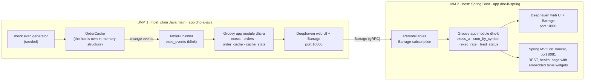

# 01. Design: Deephaven Community embedded in Java applications

**Goal.** A demo repository that shows Deephaven Community Core (DHC) running **inside** two
kinds of host application, a Spring Boot application and a plain Java application with its own
`main`, as an internal UI and query module over the host's own in-memory data. Two embedded
instances talk to each other: **DHC A** produces mock order-execution data, **DHC B** subscribes
to A's tables and derives its own.

**Fixed choices** (from the request): Deephaven 42.4, Gradle 9.2, Java 21, Groovy application-mode
modules, Gradle subprojects with shared Java code under `framework/` and one subproject per
embedded application under `apps/`, plus top-level `config`, `scripts`, `docs`, `build-logic` and
`docker`.

Every "F*n*" below refers to a finding in [00 Feasibility spike](00-feasibility-spike.md).

## 1. Shape of the solution



Two ideas keep it small:

1. **A role is a module, a host is a launcher.** What an instance *does* (role A: publish
   executions; role B: subscribe and derive) lives in a role module: a Groovy application-mode
   module plus the Java it calls. How the JVM is started (plain `main` or Spring Boot) lives in a
   host app of a few dozen lines. Any role runs in any host, so the demo can show all four
   combinations without duplicating logic.
2. **Groovy composes, Java implements.** The Groovy scripts are the readable list of tables an
   instance exposes. Anything with logic (the generator, the cache, publishing, subscribing) is
   Java in `framework/`, unit-tested without an engine where possible.

One Deephaven engine exists per JVM (F10), so A and B are always two processes.

## 2. Repository layout

```
deephaven-community-embedded/
├── settings.gradle.kts             # includes build-logic, lists subprojects
├── build.gradle.kts                # aggregate tasks only
├── gradle/
│   ├── libs.versions.toml          # every version in one place
│   ├── gradle-daemon-jvm.properties # the Gradle daemon runs on Java 21 too
│   └── wrapper/                    # Gradle 9.2.x
├── build-logic/                    # included build: convention plugins (section 3)
│   └── repositories-plugin/        # included build: the dhc.repositories settings plugin
├── framework/                      # shared Java code
│   ├── embed-core/                 # start/stop, component factory, settings, engine access
│   ├── embed-spring/               # Spring Boot auto-configuration around embed-core
│   ├── embed-testkit/              # JUnit support, table assertions, the probe client
│   └── orders-model/               # ExecEvent, OrderCache, mock generator, table definitions, oracle
├── apps/                           # embedded DHC applications
│   ├── dhc-a-module/               # role A: Groovy app module + the Java it calls
│   ├── dhc-b-module/               # role B
│   ├── dhc-a-java/                 # host: plain Java main running role A   (primary)
│   ├── dhc-b-spring/               # host: Spring Boot running role B       (primary)
│   ├── dhc-a-spring/               # host: Spring Boot running role A       (phase 6)
│   └── dhc-b-java/                 # host: plain Java main running role B   (phase 4)
├── config/                         # environment and application settings, artifact sources
├── scripts/                        # run, demo, smoke, checks (bash 3.2 compatible)
├── docker/                         # Dockerfiles, compose file, image build tasks
└── docs/
```

`config`, `scripts`, `docker` and `docs` are registered as Gradle subprojects with the `base`
plugin so each can own tasks (`validateConfig`, `shellcheck`, `buildImages`, link checks) and
take part in `./gradlew check`.

Gradle project paths: `:framework:embed-core`, `:apps:dhc-a-java`, and so on.

Java packages share the base `io.github.cmh.dhc` (decision D8), one sub-package per module.
`dhc` is Deephaven Community Core, here and in the plugin ids and `DHC_*` keys. The first plan
used `dhe`; it was renamed because DHE is the usual short name for Deephaven Enterprise, which
this project does not use:

| Module | Package |
|---|---|
| `framework/embed-core` | `io.github.cmh.dhc.embed` |
| `framework/embed-spring` | `io.github.cmh.dhc.embed.spring` |
| `framework/embed-testkit` | `io.github.cmh.dhc.testkit` |
| `framework/orders-model` | `io.github.cmh.dhc.orders` |
| `apps/dhc-a-module`, `apps/dhc-b-module` | `io.github.cmh.dhc.apps.dhca`, `io.github.cmh.dhc.apps.dhcb` |
| host apps | `io.github.cmh.dhc.apps.dhca.java`, `...dhca.spring`, `...dhcb.java`, `...dhcb.spring` |

The Gradle group is `io.github.cmh.dhc` as well.

## 3. Build logic

An included build, `build-logic/`, holds convention plugins written in the Kotlin DSL. Subproject
build files then contain only a plugin id and their dependencies.

`dhc.repositories` is the exception: it is plain Java in a second included build,
`build-logic/repositories-plugin/`, which has no dependencies and declares no repositories.
build-logic needs repositories itself (for the Kotlin DSL and Spring Boot plugins), so the plugin
that declares them cannot be built by build-logic. Kept apart, it is applied by the root build,
by build-logic and by the test fixture builds alike, and the rule "repositories come from
`repos.env` only" has no exception.

| Plugin id | Applied to | What it fixes in one place |
|---|---|---|
| `dhc.repositories` (settings plugin) | the whole build | every repository URL comes from `config/repos/repos.env`; modules may not declare repositories (`FAIL_ON_PROJECT_REPOS`) |
| `dhc.java-conventions` | every Java module | Java 21 toolchain, UTF-8, warnings as errors (`-Xlint:all` without `processing`, which Dagger's processor path would trip), JUnit 5, reproducible archives |
| `dhc.deephaven-library` | `framework/*`, role modules | Deephaven BOM as an enforced platform (F9), the Kafka extension excluded (F2), Dagger and its processor (F1), the mandatory JVM flags on tests (F3), a JVM of its own for every test class (F10), javac's `classfile` lint off (Deephaven's classes refer to annotations it does not publish) |
| `dhc.groovy-app-module` | `apps/*-module` | packages `src/main/appmode/` into the jar under `META-INF/dhc/app.d/` with an index of its files; `validateAppModule` checks the `.app` keys, that each `file_N` exists and that every script parses, and a module that fails it is not packaged. It runs on the module's own classpath, so scripts are parsed by Deephaven's Groovy 3 and not by Gradle's Groovy 4 |
| `dhc.embedded-java-app` | plain Java hosts | `application` plugin; the mandatory JVM flags (F3) on `run`, tests and the start script; Logback as the SLF4J backend; `run` gets the development settings (anonymous access, a work directory under `build/`), the installed distribution gets none of them; the config directory is wired in by P6 |
| `dhc.embedded-spring-app` | Spring hosts | Spring Boot plugin **without** `io.spring.dependency-management` (applying it fails the build), Spring's BOM as a plain platform and every library Deephaven brings pinned to Deephaven's version (F9), Tomcat WebSocket excluded (F8), JVM flags on `bootRun` and tests, an `extractBootJar` task (F7) |
| `dhc.verify-alignment` | every app (the two app plugins apply it) | `verifyDeephavenAlignment` fails the build if any library on the app's runtime classpath resolved to a different version than Deephaven alone resolves it to |

`verifyDeephavenAlignment` is the guard against F9 regressing silently when a host adds a
dependency. "Deephaven alone" is computed, not listed: the `io.deephaven` modules found on the
app's runtime classpath, resolved under the Deephaven BOM with nothing else. That reference is
resolved in a detached configuration, so a project-wide `configurations.all { force(...) }`
changes the app and not the reference; with an ordinary configuration the two moved together and
the check passed. An app with no Deephaven module fails too, rather than passing with nothing to
compare.

**Spring and versions, both directions** (F9, corrected in P1). A plain platform only suggests
versions. Where Deephaven needs a newer one than Spring manages (Jetty, Netty) Deephaven's wins by
itself. Where Spring manages a newer one than Deephaven uses (Jackson, Gson, HttpClient and
others, thirteen libraries with Spring Boot 3.5.16) Spring's would win the same way, and
`verifyDeephavenAlignment` rightly fails. So `dhc.embedded-spring-app` adds a strict constraint
for every library in the "Deephaven alone" graph. Spring decides only the libraries Deephaven
does not bring, and `dependencyInsight` names the reason for each pin.

Versions (`gradle/libs.versions.toml`):

| Component | Version | Note |
|---|---|---|
| Deephaven Community Core | 42.4 | requested |
| Gradle | 9.2.1 | newest 9.2 patch; the spike ran on 9.2.0 |
| Java | 21 | toolchain |
| Spring Boot | 3.5.16 | tested in the spike; 4.x is an open item (F9) |
| Dagger | 2.59.2 | the version Deephaven 42.4 itself resolves |
| JUnit | 5.13.4 | |
| Logback | 1.5.38 | SLF4J backend of the plain Java hosts only; Spring hosts use Spring's |
| From Deephaven, not chosen by us | Jetty 12.1.11, gRPC 1.76.2, Netty 4.1.136, protobuf 4.33.2, Groovy 3.0.25 | must not be overridden |

## 4. The framework

### 4.1 `embed-core`

The one way to run Deephaven inside a JVM. Sketch of the API a host sees:

```java
EmbeddedDeephaven dh = EmbeddedDeephaven.builder()
        .settings(EmbedSettings.load("dhc-a"))      // config files, environment, -D (section 6)
        .sideEffects(SideEffectPolicy.hostKeepsControl())   // F5; Deephaven's own behaviour if left out
        .bind("orderCache", cache)                  // host objects the Groovy module may use
        .build();
dh.start();                                         // returns once the app modules have run
Table execs = dh.table("execs");                    // a table by its published name
dh.engine().run(() -> { ... });                     // execution context + update-graph lock (F4)
dh.stop();
```

Responsibilities:

- **Component factory** (F1): our Dagger component over the published Deephaven modules,
  exposing the script session and execution context.
- **Settings to Deephaven configuration**: translates `EmbedSettings` into the properties
  Deephaven reads (`http.port`, `http.host`, `deephaven.console.type=groovy`, `AuthHandlers`,
  `deephaven.application.dir`, and per-instance `deephaven.cacheDir` / `configDir` / `dataDir`,
  F10) before initialisation.
- **App-module materialisation**: Application Mode reads a directory, so the modules named in
  `DHC_APP_MODULES` are copied from the classpath into the instance's work directory at start.
  A module `hello` is `hello.app` plus its scripts under `hello/`, in `src/main/appmode/` and in
  the jar under `META-INF/dhc/app.d/` alike. Scripts live below the module's own directory so
  that two modules in one application cannot overwrite each other's files. A jar cannot be
  listed like a directory, so the build writes `hello.index`, the list of the module's files.
  `DHC_APP_DIR` points at a source directory instead, for editing scripts without rebuilding.
- **Engine access** (F4): `engine().run / call` opens the execution context and takes the shared
  update-graph lock. Host code never touches the lock directly.
- **Host bindings**: objects registered with `bind` are visible to Groovy as `host.<name>`. No
  static registry was needed: the component contributes an application factory, which Deephaven
  runs after the script session exists and before the application scripts, and which puts the
  variable `host` into the session. (Touching the session any earlier fails, because its start-up
  scripts need calendars that the server has not loaded yet.)
- **Publishing helpers**: `RecordPublisher<T>` wraps `TablePublisher`: the host offers records
  from any thread, the helper batches them into a blink table once per update cycle.
- **Remote tables**: `RemoteTables.subscribe(upstream, tableName)` hides how the subscription is
  made (URI resolution when anonymous, a Barrage client session when authenticated) and reports
  connection state as a small status table.
- **Preflight checks with actionable messages**: missing JVM flags (F3), running from a nested
  fat jar (F6), port in use, directory not writable.
- **Process side effects** (F5): one policy object, `SideEffectPolicy`, with three switches:
  `replaceStandardStreams`, `exitJvmOnFatalError` and `installShutdownHooks`. Default for the
  plain Java host: Deephaven's behaviour, all three on. Default for the Spring host and for
  tests: `hostKeepsControl()`, all three off. The table under F5 says what each one covers and
  what cannot be controlled.
- **Start and stop**: `start()` runs Deephaven's start-up on a thread of its own and returns when
  the application modules have run. `stop()` runs Deephaven's shutdown tasks and ends its thread
  pools. Afterwards three idle daemon threads remain that nothing can end (Deephaven's reference
  cleaner, JNA's cleaner, the JDK's process reaper); none keeps the JVM alive. One instance per
  JVM, and no restart (F10).

Settings in P2 (`EmbedSettings`): `DHC_HTTP_HOST` (`localhost`), `DHC_HTTP_PORT` (10000; 0 picks
a free port), `DHC_AUTH_MODE` (`psk`; `anonymous` for development), `DHC_AUTH_PSK` (Deephaven
makes a key up and logs it when unset), `DHC_APP_MODULES`, `DHC_APP_DIR` and `DHC_WORK_DIR`
(a directory under the system temporary directory, per application).

### 4.2 `embed-spring`

A Spring Boot starter around `embed-core`: an auto-configured `EmbeddedDeephaven` bean driven by
a `SmartLifecycle` (starts after the application's own beans, stops before them), settings bound
from the same keys, a health indicator (`deephaven`, plus one per upstream), every bean
implementing `HostBinding` registered automatically, and an optional `/dhc/tables` endpoint
listing published tables. Spring's logging configuration stays in charge.

### 4.3 `orders-model`

The demo's domain, shared by both roles and by the tests:

- `ExecEvent`: `ExecID`, `OrderID`, `Symbol`, `Side`, `LastQty`, `LastPx`, `CumQty`,
  `LeavesQty`, `OrdStatus`, `TransactTime`, `Seq` (FIX 4.2 field names, as in the order-tracing
  project).
- `OrderCache`: a concurrent map of order state with change listeners. This stands in for "the
  host's own internal cache", the thing the embedding is meant to display.
- `MockExecGenerator`: seeded and deterministic; rate, order count and an optional event limit
  come from settings.
- `ExecOracle`: pure Java; given the seed and an event count, the expected state per order. Tests
  compare engine tables with it.

### 4.4 `embed-testkit`

A JUnit 5 extension that starts one embedded instance per test JVM on free ports, table
assertions against the oracle, a helper that launches another app's distribution as a child
process, and `Probe`, a small command-line Barrage client used by tests and by `scripts/smoke.sh`.
P2 delivers the extension, `TableAssertions` and `LiveThreads` (threads left behind after a
stop); the launcher and the probe come with the phases that need them (P3, P4). Because
Deephaven is one per JVM, the build gives every test class a JVM of its own.

## 5. The two roles

### Role A, `dhc-a-module`: mock order executions

```groovy
// src/main/appmode/10_tables.groovy
feed        = host.execFeed                                  // Java: generator -> OrderCache -> RecordPublisher
exec_events = feed.blinkTable()                              // one row per execution, this cycle only
execs       = RingTableTools.of(exec_events, settings.ringCapacity)   // bounded history
orders      = exec_events.lastBy("OrderID")                  // latest state per order
order_cache = host.orderCache.asTable()                      // the host's cache, as a live table
cache_stats = host.orderCache.statsTable()                   // size, updates per second, oldest entry
```

### Role B, `dhc-b-module`: subscribe to A and derive

```groovy
// src/main/appmode/10_tables.groovy
a             = host.remote("dhc-a")                         // upstream address from config
execs_a       = a.subscribe("execs")
orders_a      = a.subscribe("orders")
cum_by_symbol = orders_a.view("Symbol", "CumQty").sumBy("Symbol")
exec_rate     = execs_a.updateView("Bin = lowerBin(TransactTime, MINUTE)").countBy("Execs", "Bin")
open_orders   = orders_a.where("LeavesQty > 0")
feed_status   = a.statusTable()                              // connected, last update, lag
```

The Spring host for B adds what a business application would: `GET /api/orders/{id}` and
`GET /api/summary` reading table snapshots through `engine()`, the health indicators, and a page
at `/` that embeds the `orders_a` and `cum_by_symbol` tables with Deephaven's iframe widgets.
That page is the "internal UI module" picture: the application's own page, Deephaven's grid
inside it.

### Ports

| App | Deephaven (UI + Barrage) | Spring MVC |
|---|---|---|
| `dhc-a-java` / `dhc-a-spring` | 10000 | 8080 (Spring host only) |
| `dhc-b-java` / `dhc-b-spring` | 10001 | 8081 (Spring host only) |

A Spring host always has two ports: Deephaven brings its own Jetty and does not run inside
Tomcat. Serving both from one port through a reverse proxy in the Spring app is a stretch item.

## 6. Configuration for dev, UAT and production

```
config/
├── build.gradle.kts            # validateConfig; packages the directory as an artifact
├── defaults.env                # every key with its default and a comment
├── apps/
│   ├── dhc-a.env               # what makes this app this app: modules, default ports
│   └── dhc-b.env
├── env/
│   ├── dev.env                 # hosts, ports, upstream addresses, heap, auth mode
│   ├── uat.env
│   └── prod.env
└── repos/
    ├── repos.env               # artifact sources with public defaults
    └── repos.local.env.example # commented JFrog examples; the real override is git-ignored
```

- **One format.** Plain `KEY=value` files, readable by Java, by the shell scripts and by compose
  `env_file`, so a value is never written twice.
- **Precedence**, lowest first: `defaults.env`, `apps/<app>.env`, `env/<env>.env`, process
  environment, `-Ddhc.*` system properties. `DHC_HTTP_PORT` and `dhc.http.port` are the same key.
  A key scoped to one app wins over the unscoped one. The app id goes after the prefix, so for
  app `dhc-b` the key is `DHC_DHC_B_HTTP_PORT`.
- **Selection.** `DHC_ENV` picks the environment, `DHC_CONFIG_DIR` says where the directory is
  (the repository's `config/` in development, a mounted path in a container).
- **Environments are data, not branches.** The same commit and the same image run everywhere.
- **No secrets in the repository.** The pre-shared key and upstream credentials arrive as
  environment variables from each environment's secret store. `validateConfig` rejects any key
  that looks like a secret, and checks that every key used in one environment file exists in all
  three.
- **JVM-level settings** (heap, the mandatory flags) cannot be applied from inside the JVM. The
  start scripts and container entry points read `DHC_JVM_HEAP` and friends from the same files.

**Artifact sources.** The container registry, the Maven repository, the Gradle plugin repository
and the place Gradle distributions are downloaded from are keys in `config/repos/repos.env`, so
the build runs unchanged behind a company Artifactory: edit that file to move everyone, or add
one override file, `repos.local.env`, to move one machine. No other file names a download
address. Because the Kafka extension is excluded (F2), Maven Central and the plugin portal are
the only upstreams needed. Three details:

- The distribution key is the directory (`DHC_GRADLE_DISTRIBUTIONS_URL`), not the full URL. The
  file name carries the Gradle version, which lives in `gradle/libs.versions.toml`. The wrapper
  reads only `gradle/wrapper/gradle-wrapper.properties`, before any build logic runs, so that
  file holds the one copy of an address. `scripts/sync-gradle-wrapper.sh` writes the copy
  without needing Gradle (the `wrapper` task does the same once Gradle is there), and
  `verifyWrapper` (part of `check`) fails while the copy differs in address or version.
- A mirror that needs a login is switched on with `DHC_REPO_CREDENTIALS=gradle-properties`.
  There is one login for every repository: the Gradle properties `dhcRepoUsername` and
  `dhcRepoPassword` (`~/.gradle/gradle.properties` or `ORG_GRADLE_PROJECT_*`), never values in
  these files. The build stops with a message when they are missing. A URL with credentials in
  it is rejected.
- An unknown key is an error, so a typo does not silently fall back to the public default.

**Authentication.** Development may run anonymous, with a loud log line. Every other environment
uses a pre-shared key by default, and B presents A's key when subscribing. Deephaven binds to
localhost unless `DHC_HTTP_HOST` says otherwise.

## 7. Packaging and running

| Host | Development | Distribution | Container |
|---|---|---|---|
| Plain Java | `./gradlew :apps:dhc-a-java:run` | `installDist`: start script + `lib/`, flags baked into the script. The script names one jar, the application's, whose manifest lists the others: close to three hundred jars listed one by one are more than a Windows command line holds | `docker/Dockerfile.java-app` copies the distribution |
| Spring Boot | `./gradlew :apps:dhc-b-spring:bootRun` | `bootJar` then `extractBootJar`: thin jar + `lib/` (F7). The fat jar is never the run artifact (F6), and the app refuses to start from one with a message saying why | `docker/Dockerfile.spring-app` copies the extracted layout |

`scripts/demo.sh up|down|status|logs` starts A then B locally, `scripts/run.sh <app> [env]`
starts one, and `scripts/smoke.sh` waits for health and compares B's totals with A's through the
probe. Scripts follow the same portability rules as the sibling repositories: bash 3.2, BSD
tools, no GNU-only flags.

Images take `ARG BASE_IMAGE` (default a fully qualified Temurin 21 JRE), run as a non-root user
and declare a health check. The compose file works with Podman and Docker.

## 8. Testing

| Level | What | Where it runs |
|---|---|---|
| T1 unit | settings precedence, generator determinism, oracle, config validation | plain JUnit, no engine |
| T2 engine | role A's tables equal the oracle for a fixed seed and event count; engine access helper; publisher batching | one embedded instance per test JVM (F10) |
| T3 two-process | A started as a child process, B subscribes; B's tables equal the oracle; A stopped and restarted | `integrationTest` task |
| T4 Spring | context starts with embedded Deephaven, REST and health answer, shutdown is clean | `@SpringBootTest` |
| T5 packaging | the installed distribution and the extracted Spring layout both start and pass the smoke script; the fat jar is refused with the expected message | CI job |

The deterministic generator with an event limit is what makes T2 to T4 exact rather than
"eventually something arrives".

CI: GitHub Actions with Temurin 21, on Linux and on Windows in Git Bash, running
`./gradlew check`, the wrapper script and a start of the installed distribution from its start
script; `integrationTest` and the smoke script join when they exist. A macOS runner is added in
P7.

## 9. Risks and how the plan answers them

| Risk | Evidence | Answer |
|---|---|---|
| A host dependency silently changes a Deephaven-pinned version | F9 | `verifyDeephavenAlignment` in every app's `check` |
| Spring's BOM raises libraries above the versions Deephaven was built with | F9 correction: thirteen libraries with Spring Boot 3.5.16 | the Spring convention plugin pins them to Deephaven's; T4 and T5 are the first run of Spring on the pinned set |
| WebSocket or servlet clashes return when a host adds libraries | F8 | exclusion in the Spring convention plugin; T5 runs the real packaging |
| Someone ships the fat jar | F6 | start-up guard with a clear message; T5 negative test |
| Deephaven's process-wide handlers surprise the host | F5 | explicit side-effect policy per host, tested in T4 |
| B does not recover when A restarts | not yet tested | phase 4 measures the real behaviour first, then implements re-subscription and documents the limits |
| Authenticated subscription differs from the anonymous path | not yet tested | phase 4 spike before the helper's API is frozen |
| Upgrading Deephaven moves internal module names | F1 uses semi-internal Dagger modules | all of it is in one class in `embed-core`; an upgrade checklist in the docs |
| Licence | the engine is under the Deephaven Community License, this repository's code is MIT | stated in the README; to be read before embedding in a shipped product |

## 10. Decisions taken by default

These were not specified. The plan proceeds on the default unless changed.

| # | Decision | Default | Alternative |
|---|---|---|---|
| D1 | Which role runs in which host | all four combinations as thin apps; primary pair is A in plain Java and B in Spring Boot | only the primary pair |
| D2 | Spring Boot line | 3.5.16, tested | 4.x after a compatibility spike |
| D3 | Gradle patch | 9.2.1 | 9.2.0 |
| D4 | Kafka extension | excluded | mirror the Confluent repository and keep it |
| D5 | Config format | `.env` files shared by Java, shell and compose | `.properties` or YAML |
| D6 | Authentication | pre-shared key outside development | anonymous everywhere for a pure demo |
| D7 | Gradle DSL | Kotlin | Groovy |
| D8 | Java base package | **decided: `io.github.cmh.dhc`** (first `io.github.cmh.dhe`, renamed during P1) | |
