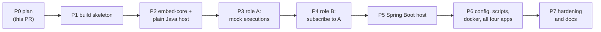

# 02. Implementation phases

Seven phases after this plan. Each is one pull request, reviewable on its own, and leaves the
repository building and runnable. A phase is done when its acceptance checks pass in CI, not when
the code exists. Findings "F*n*" are in [00](00-feasibility-spike.md), design sections in
[01](01-design.md).

## P0. Plan (this pull request)

The feasibility spike, the design and this phase plan. No code.

## P1. Build skeleton

**Delivers**

- Gradle wrapper 9.2.1, `settings.gradle.kts`, `gradle/libs.versions.toml`.
- `build-logic/` with the convention plugins of design section 3. `dhc.repositories`,
  `dhc.java-conventions`, `dhc.deephaven-library` and `dhc.verify-alignment` are complete; the
  app and module plugins exist with their dependency rules and the mandatory JVM flags (F2, F3,
  F8, F9) and are filled in by later phases.
- Fixture builds under `build-logic/src/test/fixtures/`, run with Gradle TestKit as part of
  `check`, that break each rule and expect the build to fail.
- Every subproject of the layout created with a build file and a placeholder class or README, so
  `./gradlew projects` shows the final structure.
- `config/repos/repos.env` with public defaults and `repos.local.env.example`. It is the one
  file that names a download address; `scripts/sync-gradle-wrapper.sh` copies the Gradle address
  into the wrapper, and one login (`dhcRepoUsername`, `dhcRepoPassword`) serves every repository.
- `.gitignore`, `.gitattributes` (LF everywhere, CRLF for `.bat`), `.editorconfig`.
- GitHub Actions workflow: wrapper validation, `./gradlew check`.

**Acceptance**

- `./gradlew check` is green on a clean clone with only Maven Central and the plugin portal
  reachable (proves F2 is handled).
- `./gradlew :apps:dhc-a-java:dependencies` resolves Deephaven 42.4 with Jetty 12.1.11.
- `verifyDeephavenAlignment` passes, and fails when a test fixture forces an older Jetty.
- A module that declares its own repository fails the build.

**Found while building it**

- Spring's BOM as a plain platform still raises thirteen libraries above Deephaven's versions.
  Spring hosts now pin them (the correction under F9, and design section 3).
- `verifyDeephavenAlignment` first compared against a reference that a project-wide `force`
  changed as well, so the forced-Jetty fixture passed. The reference is now detached.

## P2. `embed-core` and the plain Java host

**Delivers**

- `:framework:embed-core`: component factory (F1), `EmbeddedDeephaven` start and stop,
  `EmbedSettings` (reading defaults, environment and `-D` only; the config directory comes in
  P6), per-instance directories (F10), app-module materialisation, `engine()` access (F4), host
  bindings, preflight checks (F3, F6).
- The side-effect policy (F5): a short investigation of what `MainHelper.init` installs, then
  the policy object and its two defaults.
- `:framework:embed-testkit`: the JUnit extension and table assertions.
- `:apps:dhc-a-java` with a `hello` Groovy module (one ticking table), fully wired through
  `dhc.embedded-java-app` and `dhc.groovy-app-module`.

**Acceptance**

- `./gradlew :apps:dhc-a-java:run` starts; `http://localhost:10000/ide/` shows the `hello` table.
- T2 test: start, read `hello`, stop, with no threads left running that can be ended (see below).
- Starting without the JVM flags fails with a message that names them.
- `installDist` produces a start script that runs the same way.

**Found while building it**, and corrected in the design:

- F5 was partly wrong: `MainHelper.init` does not replace the standard streams, the server's
  start does. The full list of what changes in the process, and which switch of the policy
  covers each, is now under F5.
- Deephaven has no `stop()`. Stopping means running the shutdown tasks it registers, and then
  ending two thread pools those tasks leave running.
- "No threads left running" holds for everything that can be ended. Three idle daemon threads
  owned by process-wide singletons remain (Deephaven's reference cleaner, JNA's cleaner, the
  JDK's process reaper). The T2 test names them and fails on any other.
- The host's objects cannot be put into the script session before the server starts; the session
  cannot be created that early. An application factory in our component does it at the right
  moment, and no static registry is needed.
- A module's scripts live below `<id>/`, and the jar carries an index of the module's files,
  because a jar cannot be listed like a directory.
- A plain Java host needs an SLF4J backend of its own (Logback); Deephaven brings none.
- `validateAppModule` runs on the module's classpath, not inside Gradle, so that scripts are
  parsed by Deephaven's Groovy 3 and not by Gradle's Groovy 4.

## P3. Role A: mock order executions

**Delivers**

- `:framework:orders-model`: `ExecEvent`, `OrderCache`, `MockExecGenerator`, `ExecOracle`, table
  definitions.
- `RecordPublisher<T>` in `embed-core`.
- `:apps:dhc-a-module`: the Groovy module of design section 5 (`exec_events`, `execs`, `orders`,
  `order_cache`, `cache_stats`).
- `dhc-a-java` switched from `hello` to role A.

**Acceptance**

- T1: the generator is deterministic for a seed; the oracle agrees with a replay of its events.
- T2: with a fixed seed and an event limit, `orders` and `order_cache` equal the oracle row for
  row once the limit is reached.
- The IDE shows the five tables ticking; `order_cache` matches the Java cache's size.

**Found while building it**, and corrected in the design:

- `TransactTime` cannot come from the clock if the tables are to equal the oracle row for row.
  It follows from the generator's configuration (start time plus position times interval).
- The average price is kept as a notional sum divided by the filled quantity. A running average
  and a sum added up afterwards differ in the last bits, and "row for row" means exactly equal.
- `lastBy` puts its key column first, so `orders` begins with `OrderID` where `exec_events`
  begins with `ExecID`.
- `order_cache` is built from the cache's own change reports. Deriving it from the executions
  would have made it a second copy of `orders`, not a view of the host's cache.
- A role needs settings of its own (`DHC_GEN_*`), so `EmbedSettings` now serves any `DHC_` key
  with the usual precedence.
- The `hello` module of P2 is gone; its checks of the framework moved to role A's test.

## P4. Role B: subscribe to A

**Delivers**

- Two short investigations first, results written into the docs: an **authenticated**
  subscription (pre-shared key), and **what B's tables do when A restarts**.
- `RemoteTables` in `embed-core`, shaped by those results, with the status table.
- `:apps:dhc-b-module` and `:apps:dhc-b-java`.
- `Probe` in the test kit, and the two-process `integrationTest` task.

**Acceptance**

- T3: A runs as a child process with an event limit; B's `orders_a` and `cum_by_symbol` equal
  the oracle.
- T3: the same with a pre-shared key on A; a wrong key fails with a clear error.
- T3: A is stopped and restarted. Either B recovers on its own, or the documented limit and the
  implemented re-subscription behave as written. Whichever is true is stated in the docs.
- `feed_status` shows disconnected while A is down.

**Found while building it** (findings F12 and F13, and the design):

- Subscribing by address, as the spike did, cannot present a key. `RemoteTables` makes its own
  session in every case.
- B does not recover on its own: its tables fail within half a second of A going away and stay
  failed. The implemented answer is to reconnect and run the application scripts again; the
  limits (look tables up by name, reopen IDE panels, A's history is A's) are in the design and
  each has a test. (P5 corrected one detail: an open panel shows an error, it does not keep
  showing its last rows.)
- A's `TransactTime` start has to be a setting (`DHC_GEN_START_TIME`), or a second process
  cannot know what A's tables will contain.
- The child process is started with `java` on the distribution's application jar, not with the
  start script, so that it can be stopped the same way on every system. The start script has its
  own check (`scripts/check-start.sh`).
- The probe reads over Arrow Flight and needs no engine, so it is a client any script can run.

## P5. Spring Boot host

**Delivers**

- `:framework:embed-spring`: auto-configuration, lifecycle, settings binding, health indicators,
  automatic host bindings.
- `dhc.embedded-spring-app` completed with `extractBootJar` (F7). Its dependency rules (no
  dependency-management plugin and pinned versions, F9; Tomcat WebSocket exclusion, F8) and the
  JVM flags on `bootRun` have been in place since P1.
- `:apps:dhc-b-spring`: role B in Spring Boot, with `GET /api/orders/{id}`, `GET /api/summary`
  and the page at `/` embedding two Deephaven table widgets.

**Acceptance**

- `./gradlew :apps:dhc-b-spring:bootRun` against a running A: the page shows A's orders, the
  REST endpoints answer, `/actuator/health` reports `deephaven` and `dhc-a` as up.
- T4: the Spring context starts and stops cleanly with embedded Deephaven. This is the first
  time Spring runs on the versions pinned to Deephaven's (the spike ran on Spring's newer
  Jackson, Gson and HttpClient); a library that turns out to need Spring's version is settled
  here.
- T5: the extracted layout starts and passes the same checks; the fat jar is refused with the
  expected message.
- Stopping A turns the `dhc-a` health indicator down without stopping the Spring application.

**Found while building it** (findings F14 and F15, and the design):

- Spring runs on the library versions pinned to Deephaven's. No library needed Spring's
  version back.
- A Spring host asked to stop sometimes did not: Deephaven's `PeriodicUpdateGraph.stop()` can
  wait for ever (F14). The framework now stops the update graph under its exclusive lock. This
  was in `embed-core` since P2 and affects every host whose `stop()` is called.
- The reconnect of P4 could deadlock with host code: a request thread that held the update
  graph's lock asked the upstream for its state, while the reconnecting thread held the
  upstream's lock and waited for the update graph's. The page asks for the summary every two
  seconds, which was enough to hit it by hand. The upstream's getters and `isRunning()` no
  longer take a lock, a subscription no longer waits under the upstream's lock, and a test keeps
  clients asking through an outage. With the old locking that test hangs.
- The lifecycle order in the plan was the wrong way round for a web application: Deephaven
  starts before the web server and stops after it.
- An open table panel or widget does not keep its last rows through an outage, as P4 wrote; it
  shows an error over them. The page opens its widgets again after a reconnect.
- Spring MVC also serves Deephaven's web files from its own port (F15). Left as it is.
- `Process.destroy()` closes the parent's end of a child's output, so the test kit lost what a
  child printed while stopping. `ChildApp.stop()` now signals through the process handle and
  says whether the child ended by itself. Windows has no such request; there the stop checks
  are skipped.
- `InstanceA` moved to the test fixtures of `dhc-b-module`, so that the Spring host's tests use
  the same A as the plain ones.
- Every test task now has a time limit of twenty minutes: a locking mistake makes a test wait
  for ever, and a build that says which task ran out of time is better than one that says
  nothing.
- Stopping takes about a second with no client connected and about ten with browsers connected,
  ending with a harmless `TimeoutException` from Deephaven's Jetty. For the runbook in P7.

## P6. Configuration, scripts, containers and the full host matrix

**Delivers**

- `config/`: `defaults.env`, `apps/*.env`, `env/{dev,uat,prod}.env`, `validateConfig`; the
  config-directory layer added to `EmbedSettings` with the precedence of design section 6.
- `scripts/`: `run.sh`, `demo.sh`, `smoke.sh`, `check_env.sh`, a shared `lib.sh`.
- `docker/`: the two Dockerfiles, a compose file with A and B, `buildImages`.
- `:apps:dhc-a-spring` and `:apps:dhc-b-java`, completing the four combinations (decision D1).

**Acceptance**

- `bash scripts/demo.sh up` then `bash scripts/smoke.sh` pass locally and in CI, for both
  primary and both secondary apps.
- `DHC_ENV=uat` changes ports and upstream addresses without a rebuild.
- `validateConfig` fails on a key missing from one environment and on a secret-looking key.
- `compose up` runs A and B from images, and the smoke script passes against them.

**Found while building it** (finding F16, and the design):

- The base image has to be a JDK. On the JRE the plan named, the application does not start
  (F16). The preflight check now says so first.
- Precedence needed one more sentence than the plan had. "A scoped key wins over the unscoped
  one" holds within one place (a file, the environment, `-D`), and the place comes first. Scoped
  keys also work in the process environment, which is what lets one shell or one compose file
  give A and B different keys.
- The Spring port had no setting. It is `DHC_WEB_PORT` now, or an environment could move
  Deephaven's port and not the application's.
- The smoke script needs to read A, and a plain Java host has only Deephaven's API. The probe of
  P4 got a start script: `apps/dhc-probe`. An empty `DHC_PROBE_PSK` now means "no key".
- "B's totals equal A's" has no fixed answer while A's feed runs. The smoke script reads A, B
  and A again, and asks that B lies between the two.
- Health for containers needed two narrower questions than the overall status, which is `DOWN`
  while A is away (P5): liveness with Deephaven and without the upstream, readiness with both.
- `:apps:dhc-b-java` was already there from P4, so the fourth combination to build was only
  `:apps:dhc-a-spring`.
- Podman on macOS cannot build from a directory with several hundred jars; the context is sent
  as an archive instead, which docker takes as well.
- Stopping a background process is different in Windows Git Bash: a plain `kill` ends the
  shell's process and says nothing to the JVM below it. The scripts read the Windows process id
  first and end the process tree. There, an application is ended, not asked to stop.
- `run` and `bootRun` now take their settings from `config/` with the environment `dev`,
  instead of having anonymous access written into the build.

## P7. Hardening and documentation

**Delivers**

- Runbook and troubleshooting guide built from the failure catalogue (F2 to F10 and whatever P2
  to P6 add): symptom, cause, fix.
- An upgrade checklist for moving off 42.4: what to re-run, which class holds the semi-internal
  module list.
- macOS and Windows CI runners, with fixes.
- Stretch items, each optional and separate: one-port mode (the Spring app proxies the Deephaven
  UI), a Spring Boot 4.x compatibility spike (decision D2), TLS between A and B.

**Acceptance**

- A new reader gets from clone to both UIs with the README alone.
- CI is green on Linux, macOS and Windows.

**Found while building it** (finding F11, and the design):

- The Windows item the plan left open had a fix that could be tested without a browser. F11
  said the web IDE's layouts and notebooks needed "a Windows machine or a browser test in CI".
  The requests the web IDE sends are plain gRPC, so a test sends them, and on the Windows
  runner it fails without the interceptor that now rewrites the paths. The start was already
  worked around; this closes the other half. The web IDE itself, in a browser on Windows, is
  still not seen.
- The answers needed rewriting too, not only the requests. The storage service builds the paths
  of a listing from the platform's separator, so on Windows it would name a file
  `/layouts\main.json`, which the web IDE cannot ask for again.
- The design promised a `shellcheck` task for the scripts, and there was none: `scripts/` had
  only the `base` plugin. A real shellcheck is a program the build would have to download from
  somewhere that is not Maven Central. `checkScripts` reads the scripts as text instead and
  looks for exactly what the rule forbids: what bash learned after 3.2, and options only the
  GNU tools have. It answers the same on every machine.
- "Link checks arrive in phase P7" is `checkDocs`. It follows links between the repository's
  own files and headings and no link to another site, so the build still needs no network
  beyond its repositories.
- The failure catalogue did not stop at F10. The troubleshooting guide covers F2 to F17 and
  what P2 to P6 met without giving it a number: the lock order between host code and a
  reconnect, the Windows command-line limits, Podman on macOS, the smoke check's keys.
- The upgrade checklist names one class for the module list, as planned, and fourteen more
  places that rely on something Deephaven does not promise: property names, one thread name,
  the three JVM flags, the address of an embedded table.
- Following the README in a fresh clone found a failure no test had: the clone sat in a deep
  directory, and instance A did not start, with "File name too long" (finding F17). Deephaven
  makes a file name of an application script's whole path. The framework now gives Deephaven
  the path relative to where the JVM started when that is shorter, and refuses what is still
  too long with a message that says so.
- The README's own outage step was wrong when it was first tried. It said to stop A and start
  it again; an A that is asked to stop while B is connected takes ten seconds, so the second
  command found it still running. `scripts/demo.sh down <app>` now stops one application and
  waits until it is gone. The same trial showed that B learns of an orderly stop at the start
  of those ten seconds in one run and at their end in another; F13 had only measured a kill.
  The runbook says what to look at in between.
- The macOS runner needed no fix: every script already ran there, because the development
  machine is one. It has no container runtime, so the image steps stay on Linux.
- The three stretch items are not in this pull request: one-port mode, the Spring Boot 4.x
  spike and TLS between A and B. Each is separate work, and none is needed for the acceptance
  checks.

## What is deliberately out of scope

- Deephaven Enterprise. This project is Deephaven Community Core only: no Enterprise artifact,
  repository, API or feature is used or planned.
- Persistence. Both instances are in-memory; a restarted A starts its book again.
- Python. The embedded console is Groovy only.
- Kafka ingestion (the extension is excluded, decision D4).
- High availability, clustering and Kubernetes manifests.

## Decisions needed from you

None block P1. These change later phases if answered differently from the defaults in design
section 10:

1. **D1, host and role mapping.** Default: all four combinations, with A in plain Java and B in
   Spring Boot as the primary pair.
2. **D2, Spring Boot 3.5 or 4.x.** Default: 3.5.16, which is what was tested.
3. **D6, authentication in the demo.** Default: pre-shared key outside development.

Decided: **D8, the Java base package is `io.github.cmh.dhc`** (design section 2). It was
`io.github.cmh.dhe` until P1; the plugin ids (`dhc.*`) and configuration keys (`DHC_*`) were
renamed with it.
