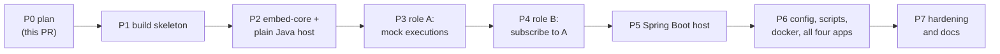

# 02. Implementation phases

Seven phases after this plan. Each is one pull request, reviewable on its own, and leaves the
repository building and runnable. A phase is done when its acceptance checks pass in CI, not when
the code exists. Findings "F*n*" are in [00](00-feasibility-spike.md), design sections in
[01](01-design.md).

## P0. Plan (this pull request)

The feasibility spike, the design and this phase plan. No code.

## P1. Build skeleton

**Delivers**

- Gradle wrapper 9.2.1, `settings.gradle.kts`, `gradle/libs.versions.toml`.
- `build-logic/` with the convention plugins of design section 3. `dhc.repositories`,
  `dhc.java-conventions`, `dhc.deephaven-library` and `dhc.verify-alignment` are complete; the
  app and module plugins exist with their dependency rules and the mandatory JVM flags (F2, F3,
  F8, F9) and are filled in by later phases.
- Fixture builds under `build-logic/src/test/fixtures/`, run with Gradle TestKit as part of
  `check`, that break each rule and expect the build to fail.
- Every subproject of the layout created with a build file and a placeholder class or README, so
  `./gradlew projects` shows the final structure.
- `config/repos/repos.env` with public defaults and `repos.local.env.example`. It is the one
  file that names a download address; `scripts/sync-gradle-wrapper.sh` copies the Gradle address
  into the wrapper, and one login (`dhcRepoUsername`, `dhcRepoPassword`) serves every repository.
- `.gitignore`, `.gitattributes` (LF everywhere, CRLF for `.bat`), `.editorconfig`.
- GitHub Actions workflow: wrapper validation, `./gradlew check`.

**Acceptance**

- `./gradlew check` is green on a clean clone with only Maven Central and the plugin portal
  reachable (proves F2 is handled).
- `./gradlew :apps:dhc-a-java:dependencies` resolves Deephaven 42.4 with Jetty 12.1.11.
- `verifyDeephavenAlignment` passes, and fails when a test fixture forces an older Jetty.
- A module that declares its own repository fails the build.

**Found while building it**

- Spring's BOM as a plain platform still raises thirteen libraries above Deephaven's versions.
  Spring hosts now pin them (the correction under F9, and design section 3).
- `verifyDeephavenAlignment` first compared against a reference that a project-wide `force`
  changed as well, so the forced-Jetty fixture passed. The reference is now detached.

## P2. `embed-core` and the plain Java host

**Delivers**

- `:framework:embed-core`: component factory (F1), `EmbeddedDeephaven` start and stop,
  `EmbedSettings` (reading defaults, environment and `-D` only; the config directory comes in
  P6), per-instance directories (F10), app-module materialisation, `engine()` access (F4), host
  bindings, preflight checks (F3, F6).
- The side-effect policy (F5): a short investigation of what `MainHelper.init` installs, then
  the policy object and its two defaults.
- `:framework:embed-testkit`: the JUnit extension and table assertions.
- `:apps:dhc-a-java` with a `hello` Groovy module (one ticking table), fully wired through
  `dhc.embedded-java-app` and `dhc.groovy-app-module`.

**Acceptance**

- `./gradlew :apps:dhc-a-java:run` starts; `http://localhost:10000/ide/` shows the `hello` table.
- T2 test: start, read `hello`, stop, with no threads left running that can be ended (see below).
- Starting without the JVM flags fails with a message that names them.
- `installDist` produces a start script that runs the same way.

**Found while building it**, and corrected in the design:

- F5 was partly wrong: `MainHelper.init` does not replace the standard streams, the server's
  start does. The full list of what changes in the process, and which switch of the policy
  covers each, is now under F5.
- Deephaven has no `stop()`. Stopping means running the shutdown tasks it registers, and then
  ending two thread pools those tasks leave running.
- "No threads left running" holds for everything that can be ended. Three idle daemon threads
  owned by process-wide singletons remain (Deephaven's reference cleaner, JNA's cleaner, the
  JDK's process reaper). The T2 test names them and fails on any other.
- The host's objects cannot be put into the script session before the server starts; the session
  cannot be created that early. An application factory in our component does it at the right
  moment, and no static registry is needed.
- A module's scripts live below `<id>/`, and the jar carries an index of the module's files,
  because a jar cannot be listed like a directory.
- A plain Java host needs an SLF4J backend of its own (Logback); Deephaven brings none.
- `validateAppModule` runs on the module's classpath, not inside Gradle, so that scripts are
  parsed by Deephaven's Groovy 3 and not by Gradle's Groovy 4.

## P3. Role A: mock order executions

**Delivers**

- `:framework:orders-model`: `ExecEvent`, `OrderCache`, `MockExecGenerator`, `ExecOracle`, table
  definitions.
- `RecordPublisher<T>` in `embed-core`.
- `:apps:dhc-a-module`: the Groovy module of design section 5 (`exec_events`, `execs`, `orders`,
  `order_cache`, `cache_stats`).
- `dhc-a-java` switched from `hello` to role A.

**Acceptance**

- T1: the generator is deterministic for a seed; the oracle agrees with a replay of its events.
- T2: with a fixed seed and an event limit, `orders` and `order_cache` equal the oracle row for
  row once the limit is reached.
- The IDE shows the five tables ticking; `order_cache` matches the Java cache's size.

## P4. Role B: subscribe to A

**Delivers**

- Two short investigations first, results written into the docs: an **authenticated**
  subscription (pre-shared key), and **what B's tables do when A restarts**.
- `RemoteTables` in `embed-core`, shaped by those results, with the status table.
- `:apps:dhc-b-module` and `:apps:dhc-b-java`.
- `Probe` in the test kit, and the two-process `integrationTest` task.

**Acceptance**

- T3: A runs as a child process with an event limit; B's `orders_a` and `cum_by_symbol` equal
  the oracle.
- T3: the same with a pre-shared key on A; a wrong key fails with a clear error.
- T3: A is stopped and restarted. Either B recovers on its own, or the documented limit and the
  implemented re-subscription behave as written. Whichever is true is stated in the docs.
- `feed_status` shows disconnected while A is down.

## P5. Spring Boot host

**Delivers**

- `:framework:embed-spring`: auto-configuration, lifecycle, settings binding, health indicators,
  automatic host bindings.
- `dhc.embedded-spring-app` completed with `extractBootJar` (F7). Its dependency rules (no
  dependency-management plugin and pinned versions, F9; Tomcat WebSocket exclusion, F8) and the
  JVM flags on `bootRun` have been in place since P1.
- `:apps:dhc-b-spring`: role B in Spring Boot, with `GET /api/orders/{id}`, `GET /api/summary`
  and the page at `/` embedding two Deephaven table widgets.

**Acceptance**

- `./gradlew :apps:dhc-b-spring:bootRun` against a running A: the page shows A's orders, the
  REST endpoints answer, `/actuator/health` reports `deephaven` and `dhc-a` as up.
- T4: the Spring context starts and stops cleanly with embedded Deephaven. This is the first
  time Spring runs on the versions pinned to Deephaven's (the spike ran on Spring's newer
  Jackson, Gson and HttpClient); a library that turns out to need Spring's version is settled
  here.
- T5: the extracted layout starts and passes the same checks; the fat jar is refused with the
  expected message.
- Stopping A turns the `dhc-a` health indicator down without stopping the Spring application.

## P6. Configuration, scripts, containers and the full host matrix

**Delivers**

- `config/`: `defaults.env`, `apps/*.env`, `env/{dev,uat,prod}.env`, `validateConfig`; the
  config-directory layer added to `EmbedSettings` with the precedence of design section 6.
- `scripts/`: `run.sh`, `demo.sh`, `smoke.sh`, `check_env.sh`, a shared `lib.sh`.
- `docker/`: the two Dockerfiles, a compose file with A and B, `buildImages`.
- `:apps:dhc-a-spring` and `:apps:dhc-b-java`, completing the four combinations (decision D1).

**Acceptance**

- `bash scripts/demo.sh up` then `bash scripts/smoke.sh` pass locally and in CI, for both
  primary and both secondary apps.
- `DHC_ENV=uat` changes ports and upstream addresses without a rebuild.
- `validateConfig` fails on a key missing from one environment and on a secret-looking key.
- `compose up` runs A and B from images, and the smoke script passes against them.

## P7. Hardening and documentation

**Delivers**

- Runbook and troubleshooting guide built from the failure catalogue (F2 to F10 and whatever P2
  to P6 add): symptom, cause, fix.
- An upgrade checklist for moving off 42.4: what to re-run, which class holds the semi-internal
  module list.
- macOS and Windows CI runners, with fixes.
- Stretch items, each optional and separate: one-port mode (the Spring app proxies the Deephaven
  UI), a Spring Boot 4.x compatibility spike (decision D2), TLS between A and B.

**Acceptance**

- A new reader gets from clone to both UIs with the README alone.
- CI is green on Linux, macOS and Windows.

## What is deliberately out of scope

- Deephaven Enterprise. This project is Deephaven Community Core only: no Enterprise artifact,
  repository, API or feature is used or planned.
- Persistence. Both instances are in-memory; a restarted A starts its book again.
- Python. The embedded console is Groovy only.
- Kafka ingestion (the extension is excluded, decision D4).
- High availability, clustering and Kubernetes manifests.

## Decisions needed from you

None block P1. These change later phases if answered differently from the defaults in design
section 10:

1. **D1, host and role mapping.** Default: all four combinations, with A in plain Java and B in
   Spring Boot as the primary pair.
2. **D2, Spring Boot 3.5 or 4.x.** Default: 3.5.16, which is what was tested.
3. **D6, authentication in the demo.** Default: pre-shared key outside development.

Decided: **D8, the Java base package is `io.github.cmh.dhc`** (design section 2). It was
`io.github.cmh.dhe` until P1; the plugin ids (`dhc.*`) and configuration keys (`DHC_*`) were
renamed with it.
